<!-- Hand-built SVGs live in ./assets (regenerate with tools/gen_assets.py). Dark + light variants via prefers-color-scheme. -->

  <a href="https://oliverseidl.dev/"><picture><source media="(prefers-color-scheme: dark)" srcset="assets/hero-dark.svg" /><source media="(prefers-color-scheme: light)" srcset="assets/hero-light.svg" /></picture></a>

 

<picture><source media="(prefers-color-scheme: dark)" srcset="assets/h-about-dark.svg" /><source media="(prefers-color-scheme: light)" srcset="assets/h-about-light.svg" />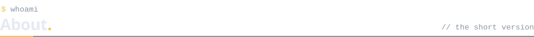</picture>

hey, I'm Oliver 👋 I build fast, modern websites for businesses as a freelancer ([oliverseidl.dev](https://oliverseidl.dev/)) and study IT at **SSPŠ** in Prague. Mostly TypeScript, React and Next.js, with a soft spot for realtime stuff and clean UI. My desktop is an Arch + Hyprland rice dressed up as macOS ([dotfiles](https://github.com/Olinkkt/dotfiles)). When I'm not coding I'm at the karting track or the gym.

 

<picture><source media="(prefers-color-scheme: dark)" srcset="assets/h-stack-dark.svg" /><source media="(prefers-color-scheme: light)" srcset="assets/h-stack-light.svg" />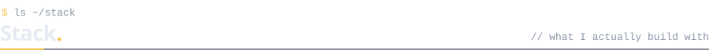</picture>

  <picture><source media="(prefers-color-scheme: dark)" srcset="assets/stack-dark.svg" /><source media="(prefers-color-scheme: light)" srcset="assets/stack-light.svg" /></picture>

 

<picture><source media="(prefers-color-scheme: dark)" srcset="assets/h-projects-dark.svg" /><source media="(prefers-color-scheme: light)" srcset="assets/h-projects-light.svg" />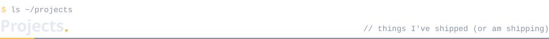</picture>

  <a href="https://github.com/Olinkkt/vibehoot"><picture><source media="(prefers-color-scheme: dark)" srcset="assets/card-slophoot-dark.svg" /><source media="(prefers-color-scheme: light)" srcset="assets/card-slophoot-light.svg" /></picture></a>
  <a href="https://github.com/Olinkkt/flexnote.xyz"><picture><source media="(prefers-color-scheme: dark)" srcset="assets/card-flexnote-dark.svg" /><source media="(prefers-color-scheme: light)" srcset="assets/card-flexnote-light.svg" /></picture></a>

  <a href="https://github.com/Olinkkt/freelancer-crm"><picture><source media="(prefers-color-scheme: dark)" srcset="assets/card-freelancer-crm-dark.svg" /><source media="(prefers-color-scheme: light)" srcset="assets/card-freelancer-crm-light.svg" /></picture></a>
  <a href="https://github.com/Olinkkt/seidl-client-portal"><picture><source media="(prefers-color-scheme: dark)" srcset="assets/card-client-portal-dark.svg" /><source media="(prefers-color-scheme: light)" srcset="assets/card-client-portal-light.svg" /></picture></a>

 

<picture><source media="(prefers-color-scheme: dark)" srcset="assets/h-stats-dark.svg" /><source media="(prefers-color-scheme: light)" srcset="assets/h-stats-light.svg" />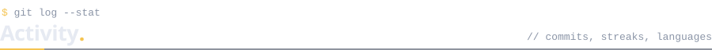</picture>

  <picture><source media="(prefers-color-scheme: dark)" srcset="https://github-readme-stats.vercel.app/api?username=Olinkkt&show_icons=true&rank_icon=github&count_private=true&bg_color=0B0F19&title_color=F5C451&text_color=E6EAF2&icon_color=F5C451&border_color=1F2A3D&border_radius=16" /><source media="(prefers-color-scheme: light)" srcset="https://github-readme-stats.vercel.app/api?username=Olinkkt&show_icons=true&rank_icon=github&count_private=true&bg_color=FFFFFF&title_color=B7791F&text_color=0F172A&icon_color=B7791F&border_color=DCE2EC&border_radius=16" /></picture>
  <picture><source media="(prefers-color-scheme: dark)" srcset="https://github-readme-stats.vercel.app/api/top-langs/?username=Olinkkt&layout=compact&langs_count=6&bg_color=0B0F19&title_color=F5C451&text_color=E6EAF2&border_color=1F2A3D&border_radius=16" /><source media="(prefers-color-scheme: light)" srcset="https://github-readme-stats.vercel.app/api/top-langs/?username=Olinkkt&layout=compact&langs_count=6&bg_color=FFFFFF&title_color=B7791F&text_color=0F172A&border_color=DCE2EC&border_radius=16" /></picture>

  <picture><source media="(prefers-color-scheme: dark)" srcset="https://streak-stats.demolab.com?user=Olinkkt&background=0B0F19&border=1F2A3D&ring=F5C451&fire=F5C451&currStreakNum=E6EAF2&sideNums=E6EAF2&currStreakLabel=F5C451&sideLabels=8B95A7&dates=8B95A7&stroke=1F2A3D&border_radius=16" /><source media="(prefers-color-scheme: light)" srcset="https://streak-stats.demolab.com?user=Olinkkt&background=FFFFFF&border=DCE2EC&ring=B7791F&fire=B7791F&currStreakNum=0F172A&sideNums=0F172A&currStreakLabel=B7791F&sideLabels=5B6678&dates=5B6678&stroke=DCE2EC&border_radius=16" /></picture>

<!-- 🐍 Optional snake animation
     1) add .github/workflows/snake.yml to this repo, 2) run it once (Actions tab -> Run workflow),
     3) once the "output" branch exists, remove this comment wrapper so the block below renders.

  <picture>
    <source media="(prefers-color-scheme: dark)" srcset="https://raw.githubusercontent.com/Olinkkt/Olinkkt/output/github-snake-dark.svg" />
    <source media="(prefers-color-scheme: light)" srcset="https://raw.githubusercontent.com/Olinkkt/Olinkkt/output/github-snake.svg" />
    
  </picture>

-->

 

<picture><source media="(prefers-color-scheme: dark)" srcset="assets/h-contact-dark.svg" /><source media="(prefers-color-scheme: light)" srcset="assets/h-contact-light.svg" />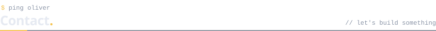</picture>

  <a href="https://oliverseidl.dev/"><picture><source media="(prefers-color-scheme: dark)" srcset="assets/btn-web-dark.svg" /><source media="(prefers-color-scheme: light)" srcset="assets/btn-web-light.svg" />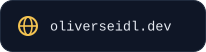</picture></a>
  <a href="mailto:kontakt@oliverseidl.dev"><picture><source media="(prefers-color-scheme: dark)" srcset="assets/btn-mail-dark.svg" /><source media="(prefers-color-scheme: light)" srcset="assets/btn-mail-light.svg" /></picture></a>
  <a href="https://www.linkedin.com/in/oliverseidl95"><picture><source media="(prefers-color-scheme: dark)" srcset="assets/btn-in-dark.svg" /><source media="(prefers-color-scheme: light)" srcset="assets/btn-in-light.svg" /></picture></a>
  <a href="https://www.instagram.com/olinkkt"><picture><source media="(prefers-color-scheme: dark)" srcset="assets/btn-ig-dark.svg" /><source media="(prefers-color-scheme: light)" srcset="assets/btn-ig-light.svg" />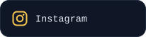</picture></a>

  <picture><source media="(prefers-color-scheme: dark)" srcset="assets/footer-dark.svg" /><source media="(prefers-color-scheme: light)" srcset="assets/footer-light.svg" /></picture>

